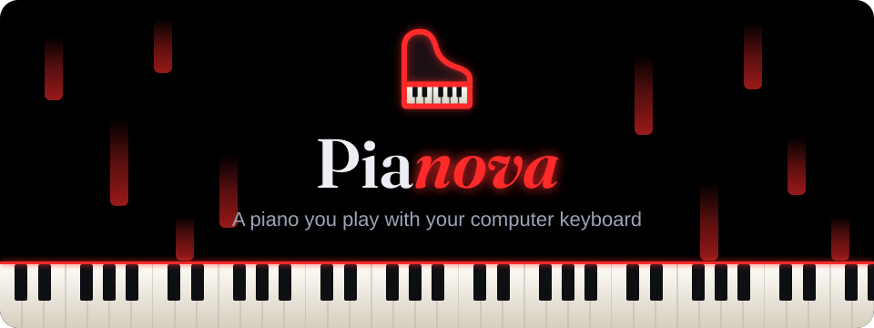
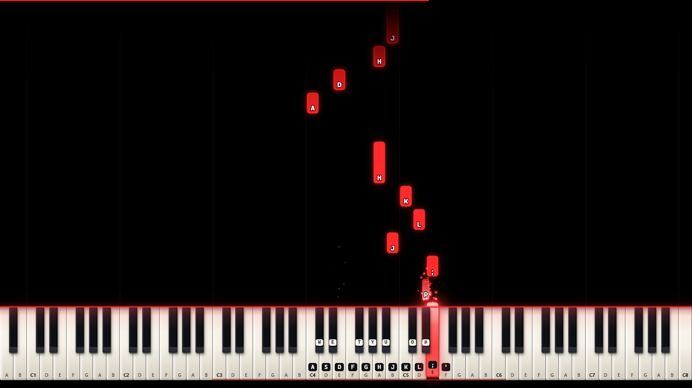
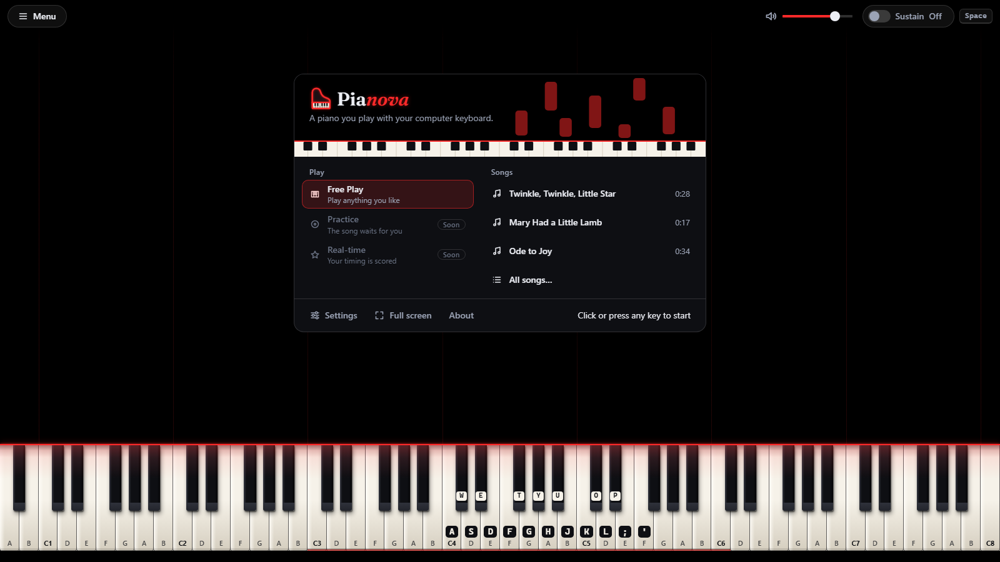

<p align="center">
  
</p>

<p align="center">
  <b>Play the piano with your computer keyboard, right in your browser.</b><br>
  One key plays one note: no Shift, no key combinations, nothing to hold down.
</p>

<h3 align="center">
  <a href="https://zoryc.github.io/Pianova/">▶ Play Pianova in your browser</a>
</h3>

<p align="center">
  <a href="LICENSE"></a>
  
  
</p>

<table>
  <tr>
    <td width="50%"></td>
    <td width="50%"></td>
  </tr>
  <tr>
    <td align="center"><sub>A song plays while its notes fall onto the keys</sub></td>
    <td align="center"><sub>The small menu it opens with</sub></td>
  </tr>
</table>

## Features

- **One key, one note.** The home row plays the white keys from middle C and the row above plays the black keys. Each piano key shows the computer key that plays it, and the mouse plays the keys too.
- **Notes of light.** The piano lies across the bottom of a dark stage, with a sampled grand piano sound. Every note you play lights its key and sends a bar of light up the screen, with sparks where it leaves the key.
- **Songs.** Six well-known starter tunes are built in, and you can import your own MIDI files with a button or by dropping them on the page. A song plays on the piano while its notes fall toward the keys, each one marked with the computer key to press. Pause, jump around, slow it down or speed it up, choose which parts play, keep only the melody, or fit the notes to the piano on screen.
- **Your own keys.** Pick a ready-made layout (Home row, Two octaves, White keys only) or click a piano key and press the computer key you want for it. Saved automatically, with a reset. The labels follow QWERTY, AZERTY and QWERTZ keyboards.
- **Make it yours.** Six themes, the colour of the light (your own colour or a rainbow), glow, backgrounds, bar styles, sparks, three key styles and four key effects, all in one Settings panel.
- **Stays out of the way.** The app opens with a small menu in the middle of the stage; one click and it is gone, and the Menu button brings it back. The bar at the top keeps only what you need while playing and hides when the mouse is still.
- **Private.** Everything stays in your browser. Nothing is uploaded.

It is made for a desktop or laptop computer with a keyboard and a mouse. Phones and tablets are not supported.

### The keys

```text
  W   E       T   Y   U       O   P        black keys
A   S   D   F   G   H   J   K   L   ;   '  white keys
C   D   E   F   G   A   B   C   D   E   F  (from middle C)
```

## Quick start

The easiest way: open **<https://zoryc.github.io/Pianova/>** in Chrome, Edge or Firefox and press a key. There is nothing to install.

To run it on your own computer, you need [Node.js](https://nodejs.org) 22 (22.22.2 or newer), 24 (24.15 or newer) or 26 and later, and a current version of Chrome, Edge or Firefox.

```bash
npm install
```

```bash
npm run dev
```

Then open <http://localhost:5173> and press a key.

**On Windows** you can skip the commands and double-click a file instead:

| File | What it does |
|---|---|
| `start-dev.bat` | Starts the development version, the same as `npm run dev`. A change to the code shows at once. |
| `start-release.bat` | Starts the release version: the compiled app, which answers a key press faster. It compiles the app first if that was never done, and tells you when the code has changed since. |
| `compile.bat` | Compiles the app into the release version. Run it again after the code has changed. |

Each file downloads what the app needs the first time. The two start files open the app in your browser at the same address, so your settings and songs are the same in both, and only one of them runs at a time. Keep the window open while you play; close it to stop the app.

> [!NOTE]
> Firefox cannot tell the app which letters are printed on your keyboard. If the letters on the piano keys do not match yours, choose your keyboard type in Settings, on the Keys tab.

## Settings

Everything works with no setup. What an experienced player may want to tune is in one Settings panel, in five tabs:

| Tab | What is in it |
|---|---|
| **Sound** | Volume, sustain (also the Space bar), touch strength, room echo, how long notes ring, transpose |
| **Keys** | The layouts and your own keys, moving the playable keys lower or higher, the keyboard type |
| **Piano** | 88, 61, 49 or 37 keys (or automatic, to suit the window), what is printed on the keys, note names as C D E or Do Ré Mi |
| **Look** | Themes, the colour of the light, glow, backgrounds, bar styles, sparks, key styles and key effects, and what is shown on screen (the bars of light, the key letters on falling notes, the names of the notes you play) |
| **About** | Credits, and a button that puts every setting back to how it was at the start |

## What comes next

Practice mode (the song waits for you), then Real-time mode with scoring, and later playing a real keyboard plugged into the computer. See [ROADMAP.md](ROADMAP.md).

## Privacy

Everything stays in your browser. Settings, custom keys and imported songs are saved in the browser's local storage; a song you import is read on your computer and never uploaded. The app makes no network requests other than downloading the piano recordings listed under Credits. Clearing the browser's site data removes your settings and imported songs.

## Development

| Command | What it does |
|---|---|
| `npm run dev` | Starts the app with live reload |
| `npm test` | Runs the unit tests |
| `npm run typecheck` | Checks the TypeScript types |
| `npm run build` | Builds the app into `dist/` |

Every change pushed to `main` is published on GitHub Pages by [`.github/workflows/pages.yml`](.github/workflows/pages.yml).

TypeScript, React and Vite, with [Tone.js](https://tonejs.github.io) for sound. Every input (computer keyboard, mouse, a song being played, and later a real instrument) sends the same "note on / note off" events through one bus, and everything else (sound, the on-screen piano, the light, later the practice modes) listens to that bus.

- [docs/ARCHITECTURE.md](docs/ARCHITECTURE.md): the note bus, the keys, the settings and the sound engine.
- [docs/INTERFACE.md](docs/INTERFACE.md): the screen.
- [docs/SONGS.md](docs/SONGS.md): MIDI import, the song library and the player.

## Credits

- **Piano sound**: Salamander Grand Piano (a Yamaha C5) by Alexander Holm, licensed [CC BY 3.0](https://creativecommons.org/licenses/by/3.0/). The MP3 copies are hosted by the [Tone.js project](https://github.com/Tonejs/audio) and are downloaded when the app starts; every third note is downloaded and the notes in between are re-pitched. The recordings are not part of this repository.
- **Starter songs**: traditional and classical melodies in the public domain, written out by hand for this app.
- **Logo typeface**: [Fraunces](https://github.com/undercasetype/Fraunces) by Undercase Type, licensed under the [SIL Open Font License 1.1](https://openfontlicense.org). It is built into the app (from the `@fontsource-variable/fraunces` package), so no font is downloaded from elsewhere; the banner draws the name in it as outlines.
- **Libraries**: React, Tone.js, midi-file and the other dependencies listed in `package.json`, each under its own licence. A production build writes their licence texts to `dist/third-party-licenses.md`.

## Licence

The code is released under the [MIT licence](LICENSE). The piano recordings are not part of this repository and keep their own licence (see Credits).
